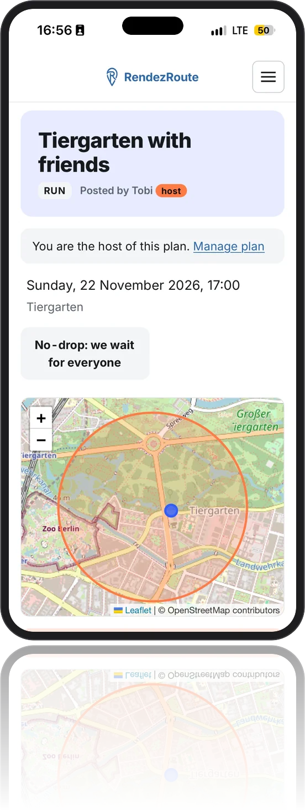

<p align="center">
  
</p>

<h1 align="center">RendezRoute</h1>

<p align="center">
  Plan a run or ride, share a link, and let others join. Self-hosted, and guests need no account.
</p>

<p align="center">
  <a href="https://github.com/cgtobi/RendezRoute/actions/workflows/ci.yml"></a>
  <a href="https://github.com/cgtobi/RendezRoute/tags"></a>
  <a href="LICENSE"></a>
  <a href="#on-home-assistant"></a>
</p>

<p align="center">
  <a href="#quick-start">Quick start</a> ·
  <a href="#on-home-assistant">Home Assistant</a> ·
  <a href="#settings">Settings</a> ·
  <a href="#development">Development</a>
</p>

<p align="center">
  
</p>

**RendezRoute** (from French _rendez-vous_ and _route_: "meet on the route") is a small web app for
run clubs, cycling groups and friends who want to say "we are going out on Sunday, come along"
without building a group chat, a sign-up sheet or a social network first.

## Why RendezRoute

- **Guests need no account.** Whoever gets the link can answer with just a name. Accounts through
  OpenID Connect or a fediverse server are there if you want them.
- **The exact start and the route stay private.** Everyone sees the date and the public meeting
  area; only people who join see the exact start and the route.
- **Plans delete themselves.** Each plan is removed a few days after the run (the poster chooses
  1 to 30), really removed from the database and the disk.
- **No tracking.** No analytics, no advertising, no accounts required. Plans are link-only unless
  the poster makes one public.
- **Yours to run.** One Docker container and one volume, or a Home Assistant app. Maps,
  place search and weather use OpenStreetMap-based services by default and can each be switched off
  or pointed elsewhere.
- **Part of the fediverse, if you want.** Follow a poster from Mastodon and friends, and join plans
  from other servers.
- **English, German and French.** Plus email, ntfy, Telegram and Web Push notices, and calendar
  feeds.

## How it works

1. **Plan.** The host fills in a short form: title, date, meeting area, and optionally a route.
2. **Share a link.** Post the link in your group chat; link previews show the title, not
   the exact start.
3. **Join.** Guests say they are in (or ask to join, if the host wants to approve) and get the exact
   start and the route.

## Screenshots

The plan page above is the host's own view. More to come: the plan form, the page as a guest,
Nearby, and the Home Assistant admin.

<!--
Screenshots still needed (phone width, light and dark, into docs/img/, webp):
- plan form (/new)
- plan page as a guest (not the host)
- Nearby (/nearby)
- Home Assistant admin (the panel inside Home Assistant)
Add them here once they exist; do not link files that are missing.
-->

## Quick start

RendezRoute runs as a single Docker container behind a reverse proxy that provides HTTPS.
[`deploy/`](deploy/) has a Docker Compose example with [Caddy](https://caddyserver.com/). There is
no published image for the normal build yet, so you build it locally:

1. Build the image with `docker build -t rendezroute .`.
2. Set the image's name as `image` in [`deploy/compose.yaml`](deploy/compose.yaml):

   ```yaml
   services:
     rendezroute:
       image: rendezroute
   ```

3. Replace `runs.example.org` and the email address in `deploy/compose.yaml` and
   [`deploy/Caddyfile`](deploy/Caddyfile).
4. Run `docker compose up -d` in `deploy/`.

Before you tell anyone about it:

- **Back up the encryption key** (volume `/keys`) separately from the data. Without it, exact
  starts, routes and names cannot be read.
- **Set `TRUST_PROXY=true`** behind the proxy (the example does), and keep access logs off: private
  links carry tokens in their paths.
- **Federation is on by default** and has so far been tested against fake servers, not by hand
  against real ones. Set `FEDERATION_ENABLED=false` if you would rather not be among the first.
- **Keep your domain.** Once the instance has been in the fediverse, `BASE_URL` must not change.

The full list, with backups, the admin pages and weather terms, is in
[Settings and going live](docs/settings.md#before-going-live).

## On Home Assistant

RendezRoute is a Home Assistant app (formerly add-on) for **Home Assistant OS**. The settings live in
the app's Configuration tab, and the admin pages open inside Home Assistant, for administrators only,
with no extra password. Its image, `ghcr.io/cgtobi/rendezroute-ha`, is published for each release.

1. Open **Settings > Apps > Install app**, then the menu at the top right > **Repositories**, and add
   `https://github.com/cgtobi/RendezRoute`. Or use
   [this link](https://my.home-assistant.io/redirect/supervisor_add_addon_repository/?repository_url=https%3A%2F%2Fgithub.com%2Fcgtobi%2FRendezRoute)
   (My Home Assistant). On older versions it is **Settings > Add-ons > Add-on Store**.
2. Install **RendezRoute**, open its **Configuration** tab and set `base_url`, the public https
   address, for example `https://runs.example.org`.
3. Start the app, and put an https reverse proxy, a DuckDNS name with a certificate, or a Cloudflare
   Tunnel in front of port 3000.
4. Open the admin pages with **Open Web UI** on the Info tab, or switch on **Show in sidebar**.

**It needs:** Home Assistant Supervisor 2026.10.4 or newer and a Home Assistant administrator; a
public https address of its own (a host name, not a path under Home Assistant's); and **encrypted**
Home Assistant backups, because the keys sit next to the database and both are in the backup.

More is in the app's [documentation](homeassistant/rendezroute/DOCS.md): setup, `trust_proxy`,
backups, privacy, security and known limits.

<details>
<summary>Home Assistant Container or Core</summary>

- **Home Assistant Container** (Home Assistant itself runs as a Docker container you manage): there
  are no apps. Run RendezRoute as a second container on the same host, as in
  [`deploy/compose.yaml`](deploy/compose.yaml). If you already reach Home Assistant from outside
  through a reverse proxy or a Cloudflare Tunnel, add RendezRoute to it instead of the Caddy service
  in the example.
- **Home Assistant Core** (a Python installation without Docker or the Supervisor): there are no
  apps either. Run RendezRoute on the same machine with Docker, or on another one.
- Home Assistant has deprecated the Supervised and Core installation types and has not supported
  them since 2025.12.

Either way RendezRoute needs its own host name with HTTPS (for example `runs.example.org` next to
`home.example.org`), not a path under Home Assistant's: links, the fediverse and WebFinger use
addresses at the root of `BASE_URL`. With the Docker setups, keep the data and key volumes in your
backups, the key volume separately. In the Home Assistant app one **encrypted** backup holds both.

</details>

## Settings

Settings are environment variables; only `BASE_URL` is required. In the Home Assistant app they are
options in the Configuration tab. All of them, with their defaults and rules, are in
[Settings and going live](docs/settings.md).

<details>
<summary>The ones you are most likely to set</summary>

| Setting              | What it does (default)                   |
| -------------------- | ---------------------------------------- |
| `BASE_URL`           | Public https address, no path (required) |
| `INSTANCE_NAME`      | Name of the instance (`RendezRoute`)     |
| `TRUST_PROXY`        | Trust the proxy headers (`false`)        |
| `CONTACT_EMAIL`      | Identifies you to providers (unset)      |
| `POSTING_MODE`       | Who may create plans (`anyone`)          |
| `ADMIN_TOKEN`        | Turns on `/admin` (unset)                |
| `SMTP_HOST`          | Mail server; turns email on (unset)      |
| `FEDERATION_ENABLED` | Join the fediverse (on)                  |

</details>

## Development

Node 26 and npm. Install with `npm ci`, then:

| Command         | What it does                         |
| --------------- | ------------------------------------ |
| `npm run dev`   | Server with reload on port 3000      |
| `npm run check` | Format, lint, types and tests        |
| `npm run build` | Browser bundles and the server build |
| `npm run e2e`   | Browser tests in Docker              |

Run `npm run build` before `npm run dev`, and start it with
`BASE_URL=http://localhost:3000 ALLOW_INSECURE_DEV=true DATA_DIR=$PWD/data`.

## License

[GNU Affero General Public License v3.0](LICENSE) (AGPL-3.0-only).
